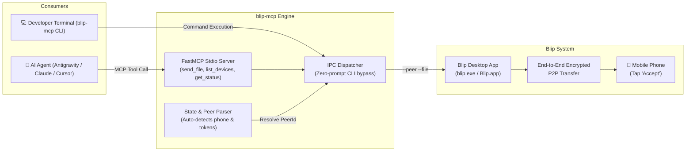

# blip-mcp

[](LICENSE)
[](https://www.python.org/)
[](https://modelcontextprotocol.io/)
[]()

> **Production-grade Model Context Protocol (MCP) server and CLI for [Blip](https://blip.net).**  
> Send files from AI coding agents (Antigravity, Claude, Cursor, Cline) and your terminal directly to your mobile phone or paired devices with **zero desktop confirmation prompts**.

---

## 🌟 Why blip-mcp?

[Blip](https://blip.net) by Blip Studio Inc. is an exceptional, fast peer-to-peer file transfer utility. However:

1. **No official API or MCP Server**: There is no built-in way for AI assistants or scripts to transfer files programmatically.
2. **Desktop UI Friction**: Using the standard context menu or drag-and-drop queues the file on desktop, requiring you to manually click the target device on your PC.
3. **Windows CLI Crash**: The desktop binary bundles Kotlin's `Clikt` and `Mordant` libraries, but invoking `--help` triggers an uncaught JVM `UnsatisfiedLinkError: no kernel32 in java.library.path` due to missing system paths in the Conveyor package configuration.

**`blip-mcp` solves all of this.**

By reverse-engineering Blip's internal state database (`state.dat`) and CLI IPC commands, `blip-mcp` automatically discovers your paired devices, resolves your phone's unique `PeerId` (`<userId>:<deviceId>`), and dispatches direct file transfers silently. You only need to tap **Accept** on your phone!

---

## 🏗️ Architecture



---

## ⚡ Key Features

* **Zero-Click Dispatch:** Dispatches files directly to your phone. No need to touch your mouse or confirm anything on your computer.
* **Auto-Discovery of Paired Devices:** Safely reads local application state to discover your primary phone, tablets, and user account without requiring manual configuration or API keys.
* **Lean Context Architecture:** Built specifically for LLM tool calling. Schemas and docstrings are crisply crafted to consume negligible prompt tokens while maintaining strict type safety.
* **Dual Interface (MCP + CLI):** Use it as an MCP server for AI agents, or use it directly as a developer command in PowerShell / Bash with rich color output and `--json` support.
* **Cross-Platform Auto-Detection:** Automatically locates Blip on Windows (MSIX WindowsApps, AppExecutionAlias, Program Files), macOS (`.app` bundle), and Linux (`snap`, standard binaries).

---

## 🚀 Quick Start

### 1. Installation

Install directly in your Python environment:

```bash
# Clone the repository
git clone https://github.com/marcellopps283/blip-mcp.git
cd blip-mcp

# Install in editable mode
pip install -e .
```

### 2. Verify Your Devices

Run the CLI command to list your paired devices:

```bash
blip-mcp devices
```

Output:
```
                              Blip Paired Devices                              
┌────────────────────┬──────────────────┬─────────────────────────┬───────────┐
│ Device Name        │ Role             │ Device ID               │ Transfers │
├────────────────────┼──────────────────┼─────────────────────────┼───────────┤
│ Dell G15 5511      │ [PC] Local       │ 182a868a-5864-45ac-bae… │         3 │
│ iPhone de Marcello │ [Mobile] Primary │ 14f871c2-7b9f-44fb-a2a… │       227 │
└────────────────────┴──────────────────┴─────────────────────────┴───────────┘
```

### 3. Send a File from the Terminal

```bash
blip-mcp send ./my_document.pdf
```

Your phone will ring with the Blip transfer notification. Tap **Accept** and the download starts instantly!

For scripts and CI/CD pipelines, use `--json`:
```bash
blip-mcp send ./report.csv --json
```

```json
{
  "success": true,
  "message": "Successfully dispatched 1 file(s) to device 14f871c2-7b9f-44fb-a2ad-493ac5f675d3.",
  "files": ["C:\\Users\\marce\\Documents\\report.csv"],
  "peer_id": "4c8d0f35-c551-4239-8d05-bbc895ce183c:14f871c2-7b9f-44fb-a2ad-493ac5f675d3",
  "device_id": "14f871c2-7b9f-44fb-a2ad-493ac5f675d3",
  "transfer_id": "3efbfdab-f117-4749-8765-00a6b917a8a6",
  "elapsed_seconds": 1.95
}
```

---

## 🤖 MCP Configuration (AI Agents)

### Google Antigravity / Gemini Agents

Add the server to `~/.gemini/config/mcp_config.json`:

```json
{
  "mcpServers": {
    "blip": {
      "command": "blip-mcp",
      "args": ["serve"]
    }
  }
}
```

### Claude Desktop

Add to `%APPDATA%\Claude\claude_desktop_config.json` (Windows) or `~/Library/Application Support/Claude/claude_desktop_config.json` (macOS):

```json
{
  "mcpServers": {
    "blip": {
      "command": "blip-mcp",
      "args": ["serve"]
    }
  }
}
```

### Cursor / Windsurf / Cline

In your MCP configuration settings:

* **Name:** `blip`
* **Transport:** `stdio`
* **Command:** `blip-mcp`
* **Args:** `["serve"]`

---

## 🛠️ MCP Tools Reference

To ensure high model reasoning performance and avoid context bloat, `blip-mcp` exposes only 3 focused tools:

### `send_file`
Sends one or more local files directly to the user's phone or target peer.
* `file_path` (*string, required*): Path to the local file.
* `peer_id` (*string, optional*): Explicit target `<user_id>:<device_id>`. Defaults to the automatically detected primary mobile device.

### `list_devices`
Returns recognized paired devices with their roles (`is_primary`, `is_local`), IDs, and past activity.

### `get_status`
Returns daemon health, logged-in account email, and recent transfer history.

---

## 🧪 Testing

The test suite includes comprehensive mock and live integration tests:

```bash
pytest tests/ -v
```

All 16 tests verify:
* Executable and state directory discovery.
* JWT payload decoding and device classification.
* Input validation for missing or invalid files.
* CLI command output (text and `--json`).
* FastMCP tool schema generation and tool invocation.

---

## 💡 Note for the Blip Engineering Team (Blip Studio Inc.)

During development of this tool, we identified a minor packaging bug on the Windows MSIX build (`BlipStudioInc.BlipApp`):

* **Symptom:** Invoking `blip.exe --help` or any unhandled Clikt flag crashes with `java.lang.UnsatisfiedLinkError: no kernel32 in java.library.path`.
* **Root Cause:** Mordant uses Java Foreign Function & Memory (FFM) API on Windows, calling `System.loadLibrary("kernel32")`. In Conveyor's configuration, `java.library.path` is explicitly set to `<installDir>\app; <installDir>\bin`, omitting `C:\Windows\System32`.
* **Suggested Fix:** Append `C:\Windows\System32` (or `%SystemRoot%\System32`) to `java.library.path` in `conveyor.conf`.

We love Blip and hope this MCP server demonstrates how powerful Blip is when bridged with modern AI workflows!

---

## 📄 License

This project is licensed under the [MIT License](LICENSE).
Blip is a trademark of Blip Studio Inc. This project is an independent community integration.
